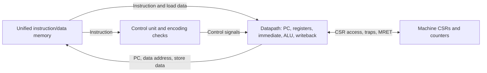

# RISC-V Single-Cycle Processor

A 32-bit, single-cycle RISC-V processor in Verilog with a unified instruction/data
memory, machine-mode exceptions, CSR operations, and automated RTL regressions.
The implemented instruction scope is **RV32I + Zicsr + Zifencei**, plus **MRET**:
**48 instruction mnemonics**.

The maintained test flow exercises the integrated RTL, including the production
memory. Validation includes **39 upstream ISA programs**, directed CSR/trap and
reset regressions, and application benchmarks compiled for RV32I with software
arithmetic. This is a simulation-validated educational core; it does not claim
full privileged-architecture compliance or a measured FPGA clock frequency.

## Quick start

Run commands from the repository root. Requirements:

| Tool | Used for |
|------|----------|
| RISC-V bare-metal GCC and binutils | Assemble/link RV32 programs and convert ELF images |
| Icarus Verilog (`iverilog`, `vvp`) | ISA, CSR/trap, and reset simulations |
| Python 3 | Memory-image conversion, benchmark runner, and result publishing |
| Verilator and a C++ compiler | Application benchmark simulations |

The GCC toolchain must support `ilp32` and provide RV32I `libgcc` helpers for the
benchmarks. The default prefix is `riscv64-unknown-elf-`; it also builds RV32 code
when the appropriate multilib is installed. No target libc installation is needed.

```sh
git submodule update --init tests/riscv-tests tests/coremark
make -j4              # ISA and directed regressions
make benchmarks       # Application benchmarks; refresh README results
make -j4 check        # Both suites
```

For a differently named toolchain:

```sh
make check RISCV_PREFIX=riscv32-unknown-elf-
```

| Target | Behavior |
|--------|----------|
| `make` / `make sim` | Build and run 39 `rv32ui` programs, the CSR/trap regression, and the reset regression |
| `make build-tests` | Build upstream ISA ELF/hex images without simulation |
| `make benchmarks` | Build/run supported applications, report skips, and update the README results section |
| `make build-benchmarks` | Build supported application ELF/hex images without simulation |
| `make coremark` | Run CoreMark performance and validation seed sets |
| `make check` | Run ISA/directed regressions and application benchmarks |
| `make clean` | Remove generated files under `sim/` |

Failures and timeouts return a nonzero exit status. Benchmark skips are reported
separately and are never counted as passes.

## Architecture

`Single_Cycle_Top` connects `Single_Cycle_Core` to one shared, little-endian
memory. The core separates instruction decoding from the datapath:



Instruction fetch, decoding, register reads, ALU operations, and memory reads are
combinational. At the rising clock edge the core advances the PC and commits
register, CSR, or memory writes. There is no pipeline or variable-latency memory
handshake: the attached memory must provide reads within the current cycle.

- **Control:** `Main_Decoder`, `ALU_Decoder`, and `Control_Unit` select operations;
  `Instruction_Check` rejects unsupported or illegal encodings.
- **Datapath:** two register read ports, one write port, immediate extension,
  operand/result multiplexers, branch comparisons, and next-PC selection.
- **Control flow:** branches and JAL use `PC + immediate`; JALR uses
  `(rs1 + immediate) & ~1`. Both jumps write `PC + 4` to the destination.
- **Exceptions:** faulting instructions suppress normal register/memory/CSR
  writes while the trap logic records exception state and redirects the PC.

For integration with another memory system, use `Single_Cycle_Core` directly.
It consumes `Instr` and `ReadData` and exposes `PC`, `ALUResult`, `WriteData`,
and `MemWrite`. Access width comes from the current instruction's `funct3`.

### Memory and reset

| Configuration | Memory | Initial image |
|---------------|--------|---------------|
| Default `Single_Cycle_Top` | 64 KiB (`MEM_WORDS=16384`) | `instructions.txt` |
| ISA testbench | 64 KiB | Selected ISA hex file |
| Benchmark testbench | 512 KiB | Selected benchmark hex file |

`MEM_WORDS` counts 32-bit words. `INIT_FILE` is a `$readmemh` image path relative
to the simulator's working directory; an empty string disables image loading.
The bundled memory initializes to zero before loading an image. The standalone
legacy `Instruction_Memory` module is not used by `Single_Cycle_Top`; it also
accepts `INIT_FILE`, defaulting to `instructions.txt`, with no machine-specific
absolute path. For example: `Instruction_Memory #(.INIT_FILE("program.hex"))`.

Reset is active high and asynchronously resets the PC to zero and the machine
CSR state. Normal writes are disabled while reset is asserted. Register `x0`
always reads zero and discards writes; `x1`–`x31` are not cleared by reset, so
software must initialize registers before using them. Reset does not clear RAM.

Stores complete on the clock edge and are visible to subsequent instruction
fetches. FENCE and FENCE.I therefore need no additional operation in this ordered,
uncached memory system. An external memory system must preserve those ordering
and instruction/data coherence guarantees.

## Instruction support

| Category | Count | Instructions |
|----------|------:|--------------|
| Register ALU | 10 | ADD, SUB, SLL, SLT, SLTU, XOR, SRL, SRA, OR, AND |
| Immediate ALU | 9 | ADDI, SLTI, SLTIU, XORI, ORI, ANDI, SLLI, SRLI, SRAI |
| Loads | 5 | LB, LH, LW, LBU, LHU |
| Stores | 3 | SB, SH, SW |
| Branches | 6 | BEQ, BNE, BLT, BGE, BLTU, BGEU |
| Upper immediate | 2 | LUI, AUIPC |
| Jumps | 2 | JAL, JALR |
| Ordering | 2 | FENCE, FENCE.I |
| Environment | 2 | ECALL, EBREAK |
| CSR | 6 | CSRRW, CSRRS, CSRRC, CSRRWI, CSRRSI, CSRRCI |
| Trap return | 1 | MRET |
| **Total** | **48** | RV32I (40), Zicsr (6), Zifencei (1), MRET (1) |

Shift amounts use the low five bits of the operand. Loads support byte/halfword
sign or zero extension. Pseudoinstructions such as `li`, `mv`, `ret`, and `nop`
expand into the instructions above and are not counted separately.

### Machine-mode exceptions and CSRs

The core executes only in machine mode, with 32-bit instruction alignment.
Initialize `mtvec` before code that can trap; its reset value is zero.

| Exception | `mcause` | `mtval` |
|-----------|---------:|---------|
| Misaligned taken branch/jump target | 0 | Target address |
| Illegal instruction or invalid CSR access | 2 | Instruction word |
| EBREAK | 3 | Instruction PC |
| Misaligned halfword/word load | 4 | Data address |
| Misaligned halfword/word store | 6 | Data address |
| ECALL from machine mode | 11 | Zero |

A trap saves the faulting PC in `mepc`, records `mcause`/`mtval`, copies MIE to
MPIE, clears MIE, and redirects execution to `mtvec`. MRET resumes at `mepc`,
restores MIE from MPIE, and sets MPIE. An untaken branch does not cause a target
alignment exception.

| CSR group | Implemented behavior |
|-----------|----------------------|
| `mstatus` | MIE/MPIE writable; MPP fixed to machine mode; reset value `0x1800` |
| `misa` | Fixed `0x40000100` (RV32I); writes ignored |
| `mtvec`, `mepc` | Direct trap vector / exception PC; low two bits forced to zero |
| `mscratch`, `mcause`, `mtval` | Read/write machine state |
| `mcycle[h]`, `minstret[h]` | 64-bit counters accessible as low/high halves |
| `cycle[h]`, `instret[h]` | Read-only aliases of the machine counters |
| `mcountinhibit` | CY and IR inhibit bits supported |
| `mie`, `mip`, `mstatush` | Fixed zero; no external interrupt inputs |
| Machine identification (`0xf11`–`0xf15`) | Read-only zero |

Unknown CSR addresses and writes to read-only CSR addresses trap. CSRRS/CSRRC
with `rs1=x0`, and their immediate variants with `zimm=0`, suppress writes.
CSRRW/CSRRWI always request a write, including a zero source. Implemented CSRs
have no read side effects. Faulting instructions do not increment `minstret`.

### Current limits

- No M multiply/divide, A atomics (including LR/SC), floating-point, compressed,
  or vector instructions. Compiler software helpers can implement arithmetic
  using the supported integer ISA.
- No user/supervisor modes, external interrupts, MMU, PMP, or caches.
- No bus-error inputs or instruction/data access-fault reporting. The bundled
  memory returns zero for out-of-range reads and ignores out-of-range writes;
  the benchmark harness explicitly fails on out-of-range accesses.
- No synthesis, timing closure, or physical performance claim is implied by the
  simulation results. Memory integration for a particular FPGA/ASIC needs its
  own implementation and timing validation.

## Validation

The maintained regression entry points are the root Makefile targets. The older
individual module benches under `tb/` are illustrative and are not all maintained
against the current interfaces.

| Suite | Coverage |
|-------|----------|
| 39 upstream `rv32ui` programs | Integer ALU, branches, jumps, loads/stores, upper immediates, and FENCE.I self-modifying code |
| `tests/directed/system.S` | All six CSR operations, read-only/unknown CSRs, ECALL/EBREAK, MRET, illegal encodings, alignment traps, suppressed writes, and counters |
| `tb/reset_tb.v` | Register, memory, and CSR write suppression during reset; execution resumes after reset |
| Application benchmarks | Compiled C workloads using the integrated core and production memory |

The ISA and directed regressions pass in Icarus Verilog. Application results are
published below. To lint the integrated top module separately:

```sh
verilator --lint-only -Irtl --top-module Single_Cycle_Top rtl/*.v
```

## Application benchmarks

```sh
make benchmarks
make benchmarks BENCHMARKS="median spmv"
make coremark
make benchmarks BENCH_MAX_CYCLES=200000000 BENCH_TIMEOUT=600
```

The upstream benchmark sources and datasets remain unchanged. Programs are
compiled with `-O2`, `rv32i_zicsr_zifencei`, and `ilp32`; RV32I `libgcc` supplies
software arithmetic, including double precision for `spmv`. Local headers declare
the freestanding runtime functions supplied by upstream `common/syscalls.c`.

The benchmark harness boots at zero, provides 512 KiB of unified memory, and
services the upstream `tohost`/`fromhost` console protocol. The local linker script
checks that the program and startup's 128 KiB stack/TLS allocation fit in memory.

Nine scalar benchmarks and two CoreMark configurations are runnable. `mm` requires an unavailable atomic barrier
and libm `fma`; `mt-*` require atomic barriers; `vec-*` require vector instructions;
`pmp` requires additional protection/privileged features. Their skip reasons are
included in each full run. Unknown benchmark names are errors.

| Output | Contents |
|--------|----------|
| `sim/bench-NAME.log` | Program output, region counters when supplied, and final status |
| `sim/benchmark-results.json` | Per-benchmark status, total cycles/instructions, region counters, and skip/failure reasons |
| README results section below | Automatically replaced summary of the latest invocation |

PASS means the upstream program exited with status zero, preserving its existing
checks. Dhrystone's normal exit is a completion check, not an independent check
of every final value. CoreMark additionally requires its explicit CRC validation
success message and no upstream errors; a zero exit code alone is insufficient.

Total cycle counts include startup, warmup, verification, and console output.
The `setStats` region counters in logs/JSON exclude much of that work but include
sampling overhead. These are ideal single-cycle-memory RTL counts, not measured
FPGA throughput. Dhrystone's printed rate assumes the upstream 1 MHz constant.

The default limits are **500,000,000 simulated cycles** and **300 wall-clock
seconds per benchmark**. Nonzero exits, unexpected traps, memory bounds errors,
and timeouts fail the target.

### Dhrystone and CoreMark scores

The generated workload-performance table uses measured-region cycles, rather
than whole-program counts. Dhrystone's iteration count comes from its upstream
header (currently 500). For example, 277,525 cycles / 500 iterations is 555.05
cycles/iteration, or approximately **1.03 DMIPS/MHz**. This includes the small
`setStats` measurement overhead and is an estimate for this build.

[CoreMark](https://github.com/eembc/coremark) is pinned as the `tests/coremark`
submodule. Its workload sources are unchanged; the machine-mode port lives in
`tests/benchmarks/coremark/`. Both the performance seeds (`0,0,0x66`) and validation
seeds (`0x3415,0x3415,0x66`) run with a 2,000-byte dataset and one context.

Defaults are `COREMARK_ITERATIONS=100` and `COREMARK_CLOCK_HZ=1000000`. The latter
is an explicit **simulation reference clock**, not a measured hardware frequency.
The port reads `mcycle`; the host derives CoreMark/MHz from exact ticks instead
of the integer-rounded seconds printed by the freestanding upstream runtime.
Compiler version and complete build flags are recorded in each CoreMark log.

```sh
make coremark COREMARK_ITERATIONS=200
```

Changing iterations or the reference clock rebuilds both CoreMark binaries.
[Upstream reporting rules](https://github.com/eembc/coremark#run-rules) require at
least 10 seconds and correct CRCs for both seed sets. The runner enforces those
checks using the declared reference clock. These are simulation estimates, not
certified submissions or measured FPGA performance; the reference-clock duration
must not be confused with simulator wall time or an achieved device clock.

### Latest benchmark results

`make benchmarks` and `make check` update only the content between the markers
below, including failures and skips. A subset run replaces the table with that
subset. If compilation fails before the runner starts, the previous results
remain in place. Generated logs and binaries under `sim/` are ignored by Git;
this README section can be committed with the corresponding RTL changes.

<!-- benchmark-results:start -->
Latest benchmark invocation (RV32I, software arithmetic). Subset runs replace this table with only the selected benchmarks.

**11 passed, 0 failed, 9 skipped.**

| Benchmark | Result | Total cycles | Instructions retired | Details |
|-----------|--------|-------------:|---------------------:|---------|
| median | PASS | 16,013 | 16,013 |  |
| qsort | PASS | 235,115 | 235,115 |  |
| rsort | PASS | 373,693 | 373,693 |  |
| towers | PASS | 13,266 | 13,266 |  |
| vvadd | PASS | 11,610 | 11,610 |  |
| memcpy | PASS | 44,975 | 44,975 |  |
| multiply | PASS | 49,201 | 49,201 |  |
| dhrystone | PASS | 295,569 | 295,569 |  |
| spmv | PASS | 3,935,622 | 3,935,622 |  |
| coremark | PASS | 74,748,972 | 74,748,972 |  |
| coremark-validation | PASS | 80,107,348 | 80,107,348 |  |
| mm | SKIP | — | — | requires an atomic barrier and libm fma (not available in this runtime) |
| mt-vvadd | SKIP | — | — | requires atomic barriers; multicore execution is unsupported |
| mt-matmul | SKIP | — | — | requires atomic barriers; multicore execution is unsupported |
| mt-memcpy | SKIP | — | — | requires atomic barriers; multicore execution is unsupported |
| pmp | SKIP | — | — | requires PMP and additional privileged features |
| vec-memcpy | SKIP | — | — | requires vector instructions |
| vec-daxpy | SKIP | — | — | requires vector and floating-point instructions |
| vec-sgemm | SKIP | — | — | requires vector and floating-point instructions |
| vec-strcmp | SKIP | — | — | requires vector instructions |

Total counts include startup, warmup, verification, and console output. These are RTL simulation results with ideal single-cycle memory.

#### Workload performance

| Benchmark | Iterations | Measured cycles | Cycles/iteration | Estimated normalized score |
|-----------|-----------:|----------------:|-----------------:|----------------------------|
| dhrystone | 500 | 277,525 | 555.05 | 1.03 DMIPS/MHz |
| coremark | 100 | 74,659,878 | 746,598.78 | 1.34 CoreMark/MHz |
| coremark-validation | 100 | 80,019,435 | 800,194.35 | CRC validation run |

Scores use the measured workload region: DMIPS/MHz = iterations × 1,000,000 / (cycles × 1757); CoreMark/MHz = iterations × 1,000,000 / cycles. These are simulation estimates, not measured hardware scores or certified benchmark submissions.

CoreMark performance seeds: `0,0,0x66`; 2,000-byte dataset; one context. Timed duration: 74.66 seconds at the explicitly assumed 1,000,000 Hz simulation reference clock. The separate validation run uses seeds `0x3415,0x3415,0x66`.

<!-- benchmark-results:end -->

## Repository layout

```text
rtl/                         Processor and memory RTL
  Single_Cycle_Top.v         Core plus shared instruction/data memory
  Single_Cycle_Core.v        Control/datapath integration
  Core_Datapath.v            Execution, writeback, next-PC and exception paths
  Control_Unit.v             Decode and branch control
  Instruction_Check.v        Complete instruction-encoding checks
  CSR_File.v                 Machine CSRs, counters, and trap state
  Data_Memory.v              Shared memory with byte/halfword access
  logger.vh                  Optional simulation logging
tb/
  riscv_tests_tb.v           Integrated ISA program harness (Icarus)
  reset_tb.v                 Reset side-effect regression
  benchmarks_tb.sv           Application/console harness (Verilator)
tests/
  directed/system.S          CSR and exception regression
  benchmarks/                Benchmark linker script, headers, and runner
  env/riscv_test.h            ISA pass/fail runtime
  link.ld                    ISA test memory layout
  bin2hex.py                 Binary-to-readmemh conversion
  riscv-tests/               Upstream tests and benchmarks (submodule)
  coremark/                  Official EEMBC CoreMark (submodule)
docs/                        Datapath documentation
instructions.txt             Example program image
Makefile                     Build, test, and benchmark entry points
```

## References and license

The original design was based on *Digital Design and Computer Architecture:
RISC-V Edition* by Sarah L. Harris and David Harris. The current RTL adds
instruction coverage, CSR/exception handling, unified memory, and automated
validation beyond the original textbook datapath.

- [RISC-V ISA specifications](https://docs.riscv.org/reference/isa/)
- [Zicsr instruction semantics](https://docs.riscv.org/reference/isa/unpriv/zicsr.html)
- [Upstream riscv-tests](https://github.com/riscv-software-src/riscv-tests)

This repository's processor code is distributed under the [MIT license](LICENSE).
The upstream test submodule retains its own license notices.
